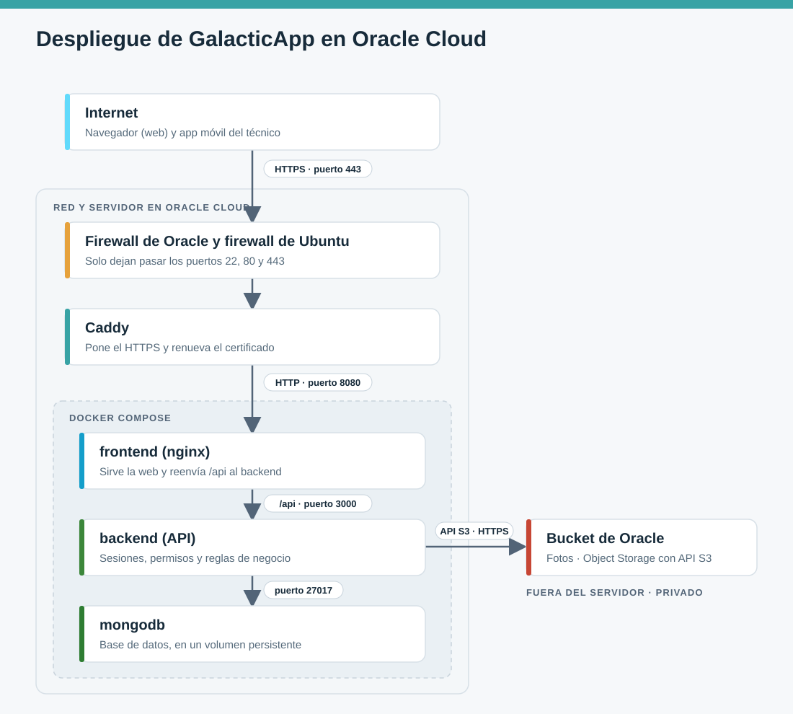

# GalacticApp · Despliegue en Oracle Cloud

Cómo quedó publicada GalacticApp en Oracle Cloud y cómo se guardan las fotos en un bucket con la API de S3.

Todo lo que se usa entra en el plan gratuito de Oracle (*Always Free*).


## 1. Resumen

| | |
|---|---|
| Dirección de la web | `https://159-54-146-55.sslip.io` |
| Dirección de la API | `https://159-54-146-55.sslip.io/api` |
| Proveedor | Oracle Cloud, región `mx-queretaro-1` (Querétaro, México) |
| Servidor | Máquina virtual `VM.Standard.A1.Flex` (procesador ARM), 2 OCPU y 12 GB de RAM, con Ubuntu 24.04 |
| Aplicación | Docker Compose con tres contenedores: `mongodb`, `backend` y `frontend` |
| HTTPS | Caddy, con certificado gratuito de Let's Encrypt que se renueva solo |
| Dominio | `sslip.io`, un servicio gratuito que convierte la IP en un nombre |
| Fotos | Bucket privado `galacticapp-imagenes` en Oracle Object Storage, usado con la API de S3 |

## 2. Cómo se conectan las partes



| De → a | Conexión | Se configura en | Para qué |
|---|---|---|---|
| Navegador o app móvil → Caddy | HTTPS, puerto 443 | `Caddyfile` | Es la única entrada pública. Caddy pone el HTTPS y maneja el certificado |
| Caddy → nginx | HTTP, `127.0.0.1:8080` | `Caddyfile` | **Proxy reverso:** Caddy recibe los pedidos de internet y se los pasa a nginx |
| nginx → backend | HTTP, `backend:3000` | `nginx.conf` | **Proxy reverso:** nginx reenvía a la API lo que empieza con `/api`. El resto lo responde él mismo con los archivos de la web |
| backend → mongodb | MongoDB, `mongodb:27017` | `docker-compose.yml` | Leer y guardar los datos, con usuario y contraseña. Solo el backend habla con la base |
| backend → bucket | HTTPS, API de S3 | `.env` del servidor | Subir y borrar fotos, y generar los links firmados |
| Navegador o app móvil → bucket | HTTPS | — | Ver una foto, con un link firmado que vence en una hora |
| Administrador → servidor | SSH, puerto 22 | Consola de Oracle | Instalar y actualizar. Se entra con una llave |

Los nombres `backend` y `mongodb` de las direcciones son los nombres de los servicios en el `docker-compose.yml`: dentro de la red interna de Docker, cada contenedor encuentra a los otros por su nombre, sin usar direcciones IP.

## 3. Qué se hizo en el servidor

1. **Red:** se creó una red virtual en Oracle con una subred pública, y en su firewall (*Security List*) se abrieron los puertos 80 y 443.
2. **Servidor:** se creó la máquina virtual con Ubuntu 24.04 e IP pública. Se entra por SSH con una llave, sin contraseña.
3. **Firewall de Ubuntu:** las imágenes de Oracle traen un segundo firewall (`iptables`) dentro del servidor. Se abrieron ahí también los puertos 80 y 443.
4. **Docker:** se instaló Docker con Docker Compose.
5. **Código:** se clonaron los repositorios del backend y del frontend (rama `develop`) en `~/galacticapp`, y se copió ahí el [docker-compose.yml](docker-compose.yml).
6. **Claves:** se creó un archivo `.env` en el servidor con la contraseña de MongoDB y la clave de las sesiones (`JWT_SECRET`), generadas al azar. Ese archivo no se sube a ningún repositorio.
7. **Aplicación:** se levantó con `docker compose up -d --build` y se cargaron los usuarios de demostración.
8. **HTTPS:** se instaló Caddy, que pide el certificado a Let's Encrypt y reenvía todo a nginx.

## 4. Las fotos en un bucket S3

### Qué se hizo

Antes, las fotos de los reclamos y de los controles de vehículo se guardaban dentro de MongoDB, como texto en base64. Ahora los archivos se guardan en un **bucket** de Oracle Object Storage y en MongoDB queda solo la referencia.

Oracle Object Storage ofrece una **API compatible con S3**, la misma interfaz que usa Amazon S3. El backend usa las librerías oficiales de S3 (`@aws-sdk/client-s3` y `@aws-sdk/s3-request-presigner`), así que para pasar a Amazon S3 u otro proveedor compatible alcanza con cambiar las variables de entorno, sin tocar el código.

### Configuración

1. En la consola de Oracle se creó el bucket `galacticapp-imagenes`, **privado**.
2. Se generaron las claves de acceso en el perfil del usuario.
3. Se agregaron cinco variables al `.env` del servidor, que el `docker-compose.yml` le pasa al backend:

   ```sh
   S3_ENDPOINT=https://<namespace>.compat.objectstorage.mx-queretaro-1.oraclecloud.com
   S3_REGION=mx-queretaro-1
   S3_BUCKET=galacticapp-imagenes
   S3_ACCESS_KEY_ID=<access key>
   S3_SECRET_ACCESS_KEY=<secret key>
   ```

### Cómo funciona

Todo el acceso al bucket está en un solo archivo del backend, `src/config/almacenamiento.js`. El cliente de S3 lleva dos ajustes propios de Oracle: el nombre del bucket va en la ruta de la dirección (`forcePathStyle`) y se desactivan las sumas de verificación automáticas de la librería.

**Al subir una foto:**

1. La web o la app la comprimen y la envían a `POST /api/imagenes`.
2. La API la valida (JPG, PNG o WebP, hasta 600 KB) y sube el archivo al bucket.
3. En MongoDB se guarda el identificador de la foto y el nombre del archivo. El reclamo, la jornada o el vehículo guardan solo ese identificador.

**Al ver una foto:**

1. La web o la app piden la foto a la API por su identificador.
2. La API comprueba la sesión y genera un **link temporal firmado**, válido por una hora.
3. El navegador o el celular descargan la foto directamente del bucket con ese link.

Como el bucket es privado, sin un link firmado nadie puede ver una foto.

Las fotos que se suben pero no quedan guardadas en ningún registro (por ejemplo, un formulario cancelado) se borran solas después de 24 horas.

No se migraron las fotos anteriores al cambio: se borraron de MongoDB.

## 5. Actualizar el servidor

Cada vez que hay cambios subidos a GitHub:

```bash
ssh ubuntu@159.54.146.55
cd ~/galacticapp/Proyecto_Final_UNAHUR_C2-Backend && git pull
cd ~/galacticapp/Proyecto_Final_UNAHUR_C2-Frontend && git pull
cd ~/galacticapp && docker compose up -d --build
```

Los datos de MongoDB no se tocan: están en un volumen de Docker aparte.

## 6. Problemas que aparecieron

| Problema | Causa y solución |
|---|---|
| La web no abría desde afuera y no se emitía el certificado | En el firewall de Ubuntu, las reglas de los puertos 80 y 443 habían quedado después de la regla que rechaza todo. Se volvieron a insertar antes de esa regla |
| Let's Encrypt dejó de responder por una hora | Tiene un límite de intentos fallidos por dominio. Se corrigió el firewall y se esperó |
| La API respondía "El almacenamiento de imágenes no está configurado" | Las variables `S3_*` no llegaban al contenedor. Se agregaron al `.env` y al `docker-compose.yml` del servidor |
| La API daba error al subir una foto | En el `.env` habían quedado valores de ejemplo en lugar de las claves reales. Se cargaron los valores reales |

## 7. Por qué Oracle Cloud

GalacticApp es una **demo**: tiene que estar disponible para mostrarla y evaluarla, pero no atiende clientes reales. Por eso el criterio principal fue que no costara nada, y que lo gratuito no se terminara antes de la entrega.

Lo que necesita la demo para funcionar:

- un servidor encendido las 24 horas, con memoria suficiente para correr a la vez MongoDB, la API y la web, y para compilar la web en cada actualización;
- una dirección pública con HTTPS, para que las contraseñas no viajen sin cifrar y porque la app móvil instalada lo exige;
- un lugar donde guardar las fotos con la API de S3.

Oracle Cloud fue la única opción que cubrió las tres cosas sin costo y sin fecha de vencimiento:

| Motivo | Detalle |
|---|---|
| **Es gratis sin límite de tiempo** | El plan *Always Free* no es una prueba de unos meses ni un crédito que se agota. La demo puede seguir publicada después de la entrega sin que llegue una factura |
| **El servidor gratuito alcanza de sobra** | La máquina que usamos tiene 2 núcleos y 12 GB de RAM. En los otros proveedores, la máquina gratuita tiene alrededor de 1 GB, que no alcanza para compilar la web y correr la base de datos al mismo tiempo |
| **Todo en un solo servidor** | Al ser una máquina virtual completa, se instala lo que haga falta. Corre el mismo `docker-compose.yml` que usamos en nuestras PC, sin adaptar nada |
| **Incluye el almacenamiento de fotos** | Object Storage tiene una capa gratuita y es compatible con la API de S3, así que cumplimos el requisito de S3 sin contratar otro servicio |
| **Siempre encendido** | La aplicación no se "duerme" cuando nadie la usa. Quien la abre para evaluarla no tiene que esperar a que arranque |

### Comparación con las alternativas

| Alternativa | Por qué no la elegimos |
|---|---|
| **Amazon Web Services** | Para cuentas nuevas, lo gratuito es un crédito que dura unos meses. Después se paga. Amazon S3 tampoco es gratis de forma permanente |
| **Microsoft Azure** | La máquina virtual gratuita dura 12 meses y es chica (alrededor de 1 GB de RAM) |
| **Google Cloud** | Tiene una máquina gratis sin vencimiento, pero muy chica (alrededor de 1 GB de RAM y una fracción de procesador). No alcanza para los tres contenedores |
| **Plataformas como Render o Railway** | Son más fáciles de usar, pero en el plan gratuito la aplicación se apaga cuando no hay visitas y tarda en volver a arrancar, o directamente lo gratuito es una prueba limitada. Además habría que repartir el sistema en varios servicios (web, API, base de datos y fotos por separado) |
| **Un servidor pago (VPS)** | Funciona igual que lo que armamos, pero cuesta unos dólares por mes. Para una demo no se justifica |

*Las condiciones de los planes gratuitos cambian seguido. Esta comparación corresponde a noviembre de 2026.*
