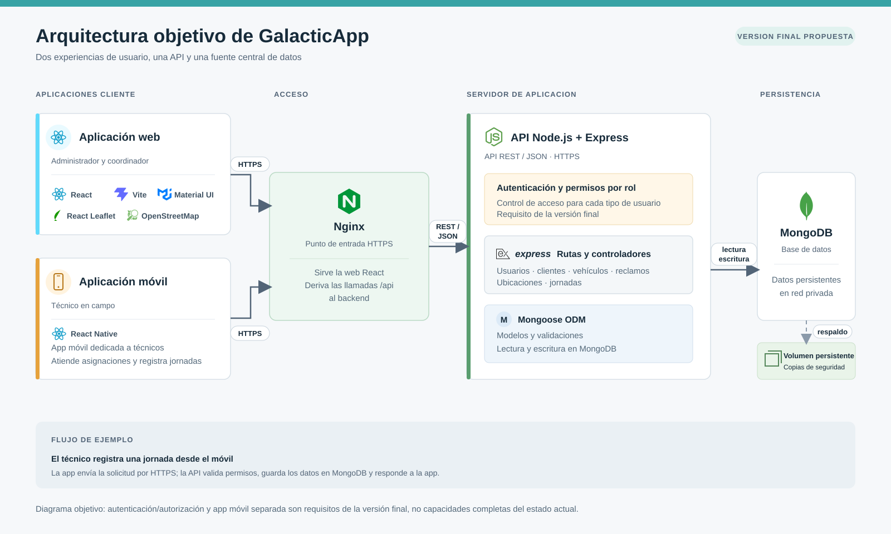
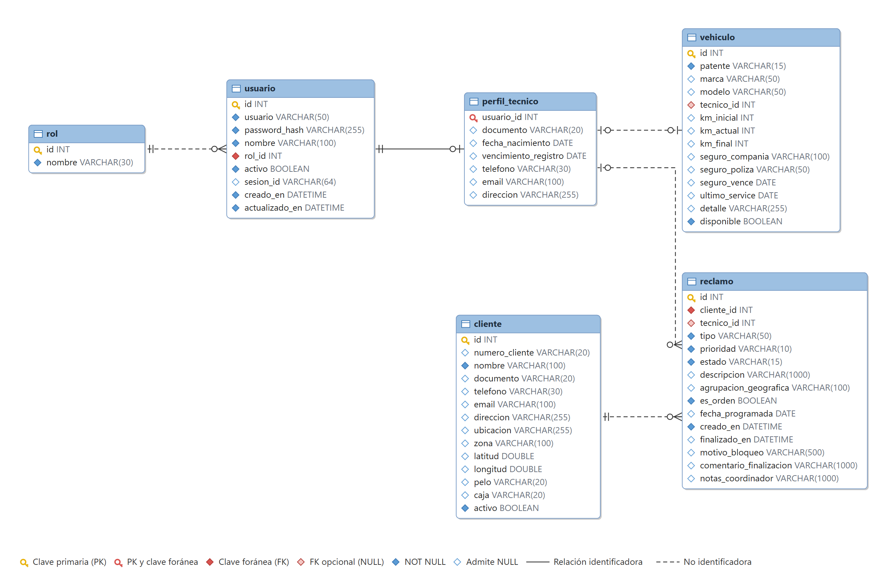

# Proyecto_Final_UNAHUR_C2
# GalacticApp · Documentación del proyecto

Proyecto Final · Universidad Nacional de Hurlingham

**Integrantes:** Agustin Cuevas · Sebastian Brandariz


- [Frontend web](https://github.com/AgusCuevas/Proyecto_Final_UNAHUR_C2-Frontend)
- [Backend](https://github.com/SebaBranda/Proyecto_Final_UNAHUR_C2-Backend)
- [Mobile](https://github.com/SebaBranda/Proyecto_Final_UNAHUR_C2---Mobile)
- [Trello](https://trello.com/invite/b/6a88691d21b9af78462b3262/ATTI74fd71c4c342de443706b929b85aba975B69CAF1/proyecto-final-unahur-c2)

---

## 1. Presentación

### Nombre del proyecto

**GalacticApp**: plataforma de gestión de servicio técnico de campo para PyMEs y proveedores de internet (ISP) locales.

### Imagen de marca

<p align="center"></p>

El logo es un cohete que sale de una órbita: representa al técnico en movimiento y a la empresa que lo sigue desde la oficina. La misma paleta se usa en la web y en la app móvil:

| Color | Hex | Uso |
|---|---|---|
| Celeste GalacticApp | `#57A2BC` | Color principal: botones, enlaces y elementos activos |
| Azul pizarra | `#536875` | Textos y variante oscura del principal |
| Lavanda | `#8299C8` | Color secundario |
| Celeste suave | `#B0CAD5` | Bordes y textos secundarios |
| Gris niebla | `#D8E0E9` | Fondos claros |

La web tiene modo claro y modo oscuro.

---

## 2. Motivación / Qué

GalacticApp centraliza en un solo sistema la gestión de los reclamos de servicio técnico: el alta, la asignación al técnico, el trabajo en la calle y el cierre. Las empresas chicas suelen manejar todo eso con WhatsApp, llamadas y planillas de Excel. El sistema tiene dos partes:

- un **sitio web** para el administrador y el coordinador;
- una **aplicación móvil** para el técnico en la calle.

### ¿Cuáles son los problemas más importantes que resolvimos?

1. **Falta de visibilidad del trabajo en la calle.** El coordinador ve en un mapa dónde está cada técnico con jornada activa y en qué estado está cada reclamo: abierto, asignado, en progreso, bloqueado o finalizado. También puede revisar el recorrido que hizo un técnico en un día.
2. **Reclamos dispersos en canales informales.** Cada reclamo queda registrado con su cliente, tipo, prioridad, zona, fecha programada, técnico asignado e historial. Ya no depende de mensajes sueltos.
3. **Trabajo sin evidencia.** Para finalizar un reclamo, el técnico tiene que escribir un comentario sobre el trabajo realizado y adjuntar al menos una foto. Si lo bloquea, tiene que indicar el motivo.
4. **Falta de control del vehículo corporativo.** Al iniciar y al cerrar cada jornada, el técnico registra el kilometraje, el nivel de combustible, el estado del vehículo y 4 fotos. El sistema no acepta un kilometraje menor que el último registrado.
5. **Gestión sin datos.** El administrador y el coordinador arman reportes propios (fuente de datos, columnas, filtros y resúmenes), los guardan, los comparten con otro rol y los exportan a CSV. Hay plantillas listas, como "Reclamos por técnico", "Tiempo de resolución por tipo" o "Productividad por técnico".
6. **Zonas sin señal.** La app móvil guarda el recorrido del técnico en el teléfono y lo envía cuando hay Wi-Fi, así no se pierde y no gasta datos móviles.

### ¿Por qué es necesaria esta herramienta?

En el servicio técnico local, la oficina, la calle y el domicilio del cliente funcionan desconectados. Esto trae varios problemas:
- los administradores no saben si un técnico está demorado o ya terminó;
- los reclamos se pierden o se duplican entre conversaciones;
- no queda registro del rendimiento de cada técnico ni del uso de los vehículos.

Las soluciones profesionales de gestión de servicio de campo existen, pero son caras y complejas para una PyME. GalacticApp ofrece lo esencial de esas herramientas, adaptado a la escala y al presupuesto de una empresa chica.

### ¿Qué diferencial aporta frente a soluciones similares?

| Competidor | Tipo | Costo aproximado | Limitación frente a GalacticApp |
|---|---|---|---|
| STApp | Nacional, directo | $19.999 ARS/mes | No tiene mapa en vivo ni seguimiento geográfico de técnicos |
| SST 2.5 (TS Sistemas) | Nacional, directo | $20.985 ARS/mes | Pensado para el taller; no está optimizado para el trabajo en la calle |
| QuadMinds / SimpliRoute | Regional, indirecto | USD 24–40 por vehículo/mes | Diseñados para entregar paquetes, no para gestionar incidentes técnicos |
| Praxedo | Internacional, directo | USD 35–65 por usuario/mes | Costo de entrada alto, mínimo de licencias y demasiado complejo para una PyME |
| MaintainX | Internacional, indirecto | USD 10–50 por usuario/mes | Orientado al mantenimiento industrial interno |

**Diferenciales de GalacticApp:**
- **Todo el circuito en un solo sistema:** alta del reclamo, asignación, trabajo en la calle con evidencia y cierre, más el control del vehículo de cada jornada.
- **Seguimiento geográfico:** mapa con la ubicación de los técnicos activos y su recorrido por día.
- **App móvil dedicada al técnico** que tolera la falta de señal: el recorrido se guarda en el teléfono y se sincroniza después.
- **Reportes configurables** por el propio usuario, sin depender de planillas.
- **Pensado para PyMEs e ISP locales:** simple de usar y de desplegar, con un costo acorde.

---

## 3. Actores / Quiénes

GalacticApp está dirigido a **pequeñas y medianas empresas de servicios técnicos de campo**, en especial proveedores de internet locales. Cada usuario tiene uno de estos tres roles:

| Actor | Dónde trabaja | Qué hace en el sistema |
|---|---|---|
| **Administrador** | Web | Gestiona usuarios y roles, clientes y vehículos; ve el panel general y el mapa de técnicos; arma reportes para tomar decisiones a partir de los datos |
| **Coordinador** | Web | Organiza la logística diaria: da de alta reclamos y órdenes de trabajo, los asigna a técnicos, sigue su estado, consulta el mapa y el recorrido de cada técnico, gestiona vehículos y arma reportes |
| **Técnico** | App móvil (y web) | Inicia y finaliza su jornada con el control del vehículo, ve sus asignaciones, abre la dirección del cliente en Google Maps, trabaja el reclamo en curso y lo finaliza o bloquea con fotos y comentarios; comparte su ubicación mientras la jornada está activa |

El **cliente final** del ISP no usa el sistema directamente: sus datos y reclamos los cargan el administrador o el coordinador. El portal de autogestión para clientes está previsto como una etapa futura (ver [Alcance](#5-alcance)).

---

## 4. Licenciamiento

- **Código de GalacticApp:** es propiedad de sus autores y se desarrolló en el marco del Proyecto Final de la UNaHur. El modelo de comercialización previsto es **software como servicio (SaaS) por suscripción mensual**, con un precio por debajo de las alternativas del mercado para que sea accesible para PyMEs.
- **Componentes de terceros:** todas las dependencias son de código abierto con licencias que permiten el uso comercial:

| Componente | Licencia |
|---|---|
| React, React Native, Expo, Material UI, Express, Mongoose, Axios, React Router y jsonwebtoken | MIT |
| Leaflet y dotenv | BSD-2-Clause |
| react-leaflet | Hippocratic License 2.1 (permite el uso, con restricciones éticas sobre derechos humanos) |
| MongoDB Community Server | SSPL (sin restricciones para usarlo como base de datos propia; solo aplica a quien ofrezca MongoDB como servicio a terceros) |
| Mapas de OpenStreetMap | Datos bajo ODbL: requieren mostrar la atribución, que el mapa ya muestra. Para un uso comercial intensivo conviene un proveedor de mosaicos propio o pago, según la política de uso de los servidores de OSM |

---

## 5. Alcance

### Incluido en esta versión

- **Autenticación y roles:**
  - login con usuario y contraseña;
  - una sesión activa por usuario: si ingresa desde otro dispositivo, la sesión anterior se cierra;
  - bloqueo temporal después de varios intentos fallidos.
- **Usuarios:** alta, edición, deshabilitación y perfiles según el rol.
- **Clientes:** alta, edición, búsqueda y deshabilitación. Cada cliente tiene datos de contacto, domicilio, zona, coordenadas y datos de conexión (pelo y caja).
- **Reclamos y órdenes de trabajo:**
  - alta, asignación y reasignación a técnicos;
  - estados Abierto, Asignado, En progreso, Bloqueado y Finalizado;
  - prioridades y fecha programada;
  - fotos de evidencia y comentario de cierre obligatorio.
- **Vehículos:**
  - alta y asignación a un técnico;
  - kilometraje, seguro y vencimientos;
  - historial de controles.
- **Jornadas del técnico:**
  - inicio y cierre con el control del vehículo (kilometraje, combustible, estado y 4 fotos);
  - historial y resumen de desempeño.
- **Seguimiento geográfico:**
  - mapa con la última ubicación de cada técnico, que se envía cada 5 minutos con la jornada activa;
  - recorrido de un técnico por día.
- **Reportes:**
  - generador con fuentes de datos (reclamos, clientes, técnicos, jornadas, vehículos y controles), filtros, orden y resúmenes;
  - plantillas listas, reportes guardados y compartidos por rol;
  - exportación a CSV.
- **App móvil del técnico:**
  - asignaciones, servicio en curso, vehículo y jornada;
  - fotos con la cámara;
  - recorrido guardado en el teléfono cuando no hay señal y sincronizado por Wi-Fi.
- **Web adaptable** a celular, tablet y escritorio, con modo claro y oscuro.

### Fuera de alcance (posibles etapas futuras)

- Portal de autogestión para que el cliente final cargue y siga sus reclamos, con encuesta de satisfacción.
- Notificaciones push al técnico ante una urgencia o una reasignación.
- Optimización automática de rutas y sugerencia del técnico más cercano.
- Funcionamiento sin conexión de toda la app móvil. Hoy solo el recorrido se guarda sin señal; finalizar un reclamo o una jornada requiere conexión.
- Registro de materiales usados y de mediciones técnicas (por ejemplo, la potencia de la señal).

---

## 6. Tecnologías

| Capa | Tecnologías |
|---|---|
| Frontend web | React 19, Vite 8, Material UI 9, React Router 7, Axios, Leaflet + react-leaflet (OpenStreetMap) |
| App móvil | React Native 0.88 con Expo SDK 58, Expo Router, expo-location, expo-image-picker, AsyncStorage y NetInfo |
| Backend | Node.js 20, Express 5, Mongoose 9, JSON Web Tokens (jsonwebtoken), scrypt para contraseñas |
| Base de datos | MongoDB 7 |
| Infraestructura | Docker y Docker Compose; nginx como servidor web y proxy de la API; servidor en Oracle Cloud |
| Herramientas | Git y GitHub, ESLint, Postman (colección de pruebas de la API) y Trello (organización del trabajo) |

**Lenguaje:** JavaScript en todo el sistema (web, móvil y backend). Usar un solo lenguaje y el mismo cliente HTTP (Axios) en la web y el celular permite reutilizar conocimiento y lógica entre los tres proyectos.

---

## 7. Arquitectura

GalacticApp sigue una arquitectura **cliente-servidor en tres capas**. Dos aplicaciones cliente (web y móvil) consumen una única **API REST**, que es la única que accede a la base de datos.



### Componentes

- **Aplicación web (SPA):** una sola aplicación React con un panel por rol. Al compilarse con Vite queda como archivos estáticos que sirve nginx.
- **App móvil:** aplicación Expo para el técnico. Usa los mismos endpoints que la web. Accede al GPS, a la cámara y al almacenamiento local del teléfono para la cola del recorrido.
- **nginx:** es el punto de entrada. Sirve la web y reenvía las llamadas a `/api` al backend, así la web y la API comparten el mismo origen. La API no se expone directamente a internet.
- **API REST (backend):** organizada en capas, donde cada recurso tiene sus propios archivos:

  ```
  ruta → middleware (autenticación y rol) → controlador → servicio → repositorio → modelo
  ```

  - el **controlador** maneja la petición y la respuesta HTTP;
  - el **servicio** concentra las reglas de negocio y las validaciones;
  - el **repositorio** es el único que consulta la base de datos.
- **MongoDB:** base de datos documental, con volumen persistente. Solo es accesible desde la red interna de Docker.

### Seguridad

- **Autenticación:** con JWT firmados con HS256 y vigencia de 1 hora, enviados en la cabecera `Authorization`.
- **Sesión única por usuario:** el token lleva un identificador de sesión que el backend compara con la sesión vigente del usuario.
- **Autorización en dos niveles:**
  - por ruta: qué roles pueden usar cada endpoint;
  - por datos: por ejemplo, un técnico solo ve sus propios reclamos.
- **Contraseñas** guardadas con hash `scrypt` y sal aleatoria.
- **Login:** bloqueo temporal después de 5 intentos fallidos.
- **Cabeceras de seguridad** en nginx y en la API, y CORS limitado a los orígenes configurados.

### Flujo de ejemplo: el técnico finaliza un reclamo

1. Desde la app móvil, el técnico saca las fotos del trabajo. La app las comprime y las sube a `POST /api/imagenes`, que devuelve sus identificadores.
2. La app envía `PATCH /api/reclamos/:id/estado` con el estado `Finalizado`, el comentario y los identificadores de las fotos.
3. La API comprueba:
   - que el token y la sesión sean válidos;
   - que el reclamo sea del técnico;
   - que haya al menos una foto y un comentario.

   Después actualiza el reclamo en MongoDB y registra un punto del recorrido.
4. La próxima vez que el coordinador consulta la lista de reclamos, lo ve como finalizado, y los reportes lo incluyen.

### Despliegue

Todo el sistema se levanta con `docker compose up -d --build`, que crea tres contenedores:
- `mongodb`;
- `backend`;
- `frontend`, que es nginx con la web compilada.

En producción corre en una máquina virtual de Oracle Cloud. Para actualizarla se descarga la última versión (`git pull`) y se reconstruyen los contenedores. Los datos de demostración se cargan opcionalmente con la variable `SEED_DEMO_DATA`.

---

## 8. Modelo de entidades

La aplicación guarda los datos en **MongoDB**. Para documentar el diseño, el modelo se presenta como un **diagrama entidad-relación físico** equivalente en tablas relacionales, en primera forma normal. Los objetos anidados de los documentos de Mongo, como el kilometraje, el seguro o las coordenadas, se representan como columnas.



El script SQL que define estas tablas está en [der-galacticapp.sql](der-galacticapp.sql).

### Entidades principales

| Entidad | Descripción | Atributos principales |
|---|---|---|
| **rol** | Tipo de usuario: Administrador, Coordinador o Técnico | `id`, `nombre` |
| **usuario** | Persona que ingresa al sistema | `id`, `usuario`, `nombre`, `rol_id`, `activo` |
| **perfil_tecnico** | Datos propios del técnico | `usuario_id`, `documento`, `telefono`, `email`, `vencimiento_registro` |
| **cliente** | Cliente del ISP que recibe el servicio | `id`, `numero_cliente`, `nombre`, `direccion`, `zona`, `latitud`, `longitud`, `pelo`, `caja` |
| **vehiculo** | Vehículo corporativo | `id`, `patente`, `marca`, `modelo`, `tecnico_id`, `km_actual`, `seguro_vence` |
| **reclamo** | Reclamo u orden de trabajo sobre un cliente | `id`, `cliente_id`, `tecnico_id`, `tipo`, `prioridad`, `estado`, `fecha_programada`, `finalizado_en` |

### Relaciones

| Relación | Cardinalidad | Detalle |
|---|---|---|
| Rol – Usuario | 1 a N | Cada usuario tiene un único rol; un rol agrupa a muchos usuarios |
| Usuario – Perfil técnico | 1 a 0..1 | Solo los usuarios con rol Técnico tienen perfil de técnico |
| Técnico – Vehículo | 0..1 a 0..1 | Un técnico tiene como máximo un vehículo asignado, y un vehículo puede estar sin asignar |
| Técnico – Reclamo | 0..1 a N | Un técnico atiende muchos reclamos; un reclamo puede estar todavía sin técnico |
| Cliente – Reclamo | 1 a N | Un cliente puede tener muchos reclamos; cada reclamo pertenece a un solo cliente |

### Entidades de soporte

No están en el diagrama para mantener el foco en el negocio principal, pero forman parte del sistema:

- **Jornada:** turno de trabajo del técnico, con su control inicial y final del vehículo. Los reclamos finalizados quedan asociados a la jornada en la que se cerraron.
- **Control de vehículo:** registro de kilometraje, combustible, estado y fotos.
- **Imagen:** fotos de evidencia de los reclamos y de los controles.
- **Ubicación y punto de recorrido:** la última posición de cada técnico y las posiciones que registró durante cada jornada.
- **Reporte:** definición guardada de un reporte (fuente, columnas, filtros y resumen), con los roles con los que se comparte.
